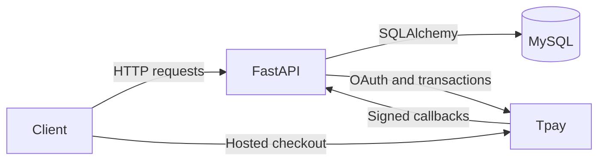

# Tpay Bridge

An asynchronous service that connects an existing MySQL billing database to [Tpay](https://tpay.pl), an online payment gateway that hosts checkout and processes payments. It retrieves invoices by UUID, creates payment and donation transactions, and updates invoice status from signed provider notifications.

The backend uses asynchronous database and HTTP calls, caches and refreshes OAuth tokens, verifies detached JWS signatures, and updates the database within transactions.

## Architecture

The existing billing database stores the invoice data and payment status. The service reads billing records to create Tpay transactions and updates those records when payment notifications arrive. Both operations run within HTTP requests. Separate modules handle routes, Tpay API calls, database access, token caching, and signature verification.

| Module | Responsibility |
| --- | --- |
| `main.py` | Routes, request orchestration, notification status mapping. |
| `tpay.py` | Invoice retrieval, payer selection, transaction payloads, status updates. |
| `db.py` | Async engine, request-scoped connection dependency, SQL execution and row conversion. |
| `sql/` | Parameterized invoice lookup and conditional status update. |
| `models.py` | NamedTuple models and public invoice serialization. |
| `storage.py` | Process-local OAuth token cache and synchronized refresh. |
| `signature.py` | Certificate retrieval and detached JWS verification. |
| `settings.py` | Environment loading, provider endpoints, timeout, donation limits, return URL, chargeback policy. |

## HTTP API

These paths are registered directly on FastAPI. Checkout creation returns a provider URL for the client to follow.

| Method | Endpoint | Query parameters | Result |
| --- | --- | --- | --- |
| GET | `/info` | `uuid: str` | Public invoice JSON, including amount and paid flag; 404 if not found. |
| GET | `/create` | `uuid: str`, `payer: int` | Creates invoice checkout; returns `{"url": "…"}`. 404 if missing, 409 if already paid. |
| GET | `/create-donation` | `uuid: str`, `payer: int`, `amount: int` | Creates donation checkout; returns `{"url": "…"}`. 404 if invoice lookup fails, 400 if amount is outside 1–9,999. |
| POST | `/callback` | None | Verifies a signed form notification, applies a status update, returns plain-text `TRUE`. |
| GET / HEAD | `/token-test` | None | Obtains a cached or refreshed OAuth token. GET returns its first character. |

`/stats/` provides additional endpoints for README badge statistics.

FastAPI returns 422 for missing required query parameters or invalid parameter types. Payer selection treats zero as the first payer and any nonzero integer as the second. Invoice access uses the UUID supplied in the link. Public invoice serialization partially masks identifying data, while the backend supplies full payer data to the payment provider.

## Transaction creation

1. Retrieve the invoice through a parameterized join of billing and payer records. The lookup requires at least one payer with non-null contact data.
2. For invoice payments, reject an already-paid record and derive the amount from the database. For donations, validate the supplied integer amount; an already-paid invoice can still supply payer data.
3. Obtain an OAuth token from Tpay's `/oauth/auth` endpoint. The cache refreshes on demand when a token is missing or within 60 seconds of expiry by default. An `asyncio.Lock` and a second expiry check coordinate concurrent refresh requests within one process; multiple processes maintain independent caches.
4. POST to Tpay's `/transactions` endpoint with a bearer token, amount, description, selected payer, correlation value, and browser return URLs. The `hiddenDescription` field carries the invoice identifier for payments and `donation <invoice_id>` for donations.
5. Return the hosted checkout URL. Both browser success and error URLs lead back to the corresponding client page with the UUID preserved. Browser redirects do not update payment status.

HTTPX requests use a configurable timeout, currently five seconds. Token and transaction requests call `raise_for_status()`, which raises an exception when Tpay returns an HTTP error.

## Notification processing

The callback requires an `X-JWS-Signature` header and a form body containing `tr_id`, `tr_status`, and `tr_crc`. It reads the original body bytes, fetches the configured PEM certificate, constructs a JWK, and verifies the detached JWS against those bytes before parsing the form.

| Provider status | Paid flag |
| --- | --- |
| `TRUE` | True |
| `CHARGEBACK` | False by default; true when `CHARGEBACK_UPDATES_STATUS` is disabled |
| Any other value | False |

The update matches `tr_crc` against the invoice identifier and writes the paid flag, database timestamp, and `tr_id`. It only updates rows whose paid flag changes. Repeated notifications with the same flag therefore leave the stored timestamp and transaction ID unchanged.

The connection dependency uses `engine.begin()`, which commits on success and rolls back on exceptions. The callback returns `TRUE` when processing completes, even if no database row changed.

## Current behavior and limits

The database stores the current invoice payment status. Keep these details in mind when changing or extending the service:

- SQL result columns map positionally into the `Invoice` NamedTuple; query column order and model field order must remain aligned.
- Status updates only run when the paid flag changes. Notifications are not deduplicated by transaction ID, and payment history is not stored. With the default configuration, a chargeback marks a paid invoice unpaid without checking whether another successful payment still covers it.
- Donation checkout is supported, but donation notifications need separate handling of the `donation <invoice_id>` prefix. The current callback matches the correlation value directly against the invoice identifier.
- The callback verifies the signature but does not compare the notified amount with the invoice amount. It fetches the verification certificate for each request.
- Checkout creation currently uses GET and has no local idempotency key or reservation step. Repeated requests can create multiple provider transactions before payment confirmation.
- Invoice access uses UUID links without a separate login. Tpay requests have no automatic retries, and provider errors have no custom API response format.

## Runtime and configuration

Requires Python 3.12+ for the generic function syntax in `db.py`. Dependencies are pinned in `requirements.txt`; the core stack is FastAPI, HTTPX, SQLAlchemy, aiomysql, and jwcrypto.

| Environment variable | Purpose |
| --- | --- |
| `DATABASE_URI` | Async SQLAlchemy MySQL URL using `mysql+aiomysql://…`. |
| `TPAY_CLIENT_ID` | OAuth client ID. |
| `TPAY_SECRET` | OAuth client secret. |

Variables are loaded from the environment or `.env`. `settings.py` selects production endpoints by default (`SANDBOX = False`); sandbox mode switches API and certificate URLs. It also defines the browser return URL, timeout, donation limits, and chargeback behavior.

Run the API with `uvicorn main:app --reload`. The optional client in `vite-project` requests `/api/*`; its development proxy removes that prefix and forwards to port 8000. Production hosting must provide equivalent routing. Deployment configuration is not included.

`test/` contains manual curl helpers. The callback helper shows an example payload but omits the required JWS signature. Testing the paid-status update also requires the uppercase `TRUE` status. There are no automated integration tests.
